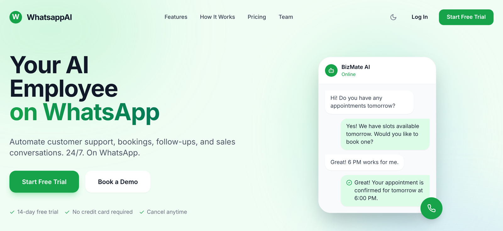
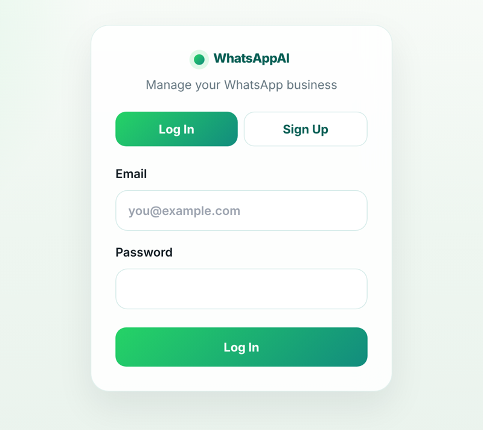

<div align="center">

# 💬 WhatsAppAI

### A multi-tenant SaaS for running a small business on WhatsApp


</div>

---

## The idea

Shops, salons, clinics and food businesses already talk to their customers on WhatsApp, but orders, payments, follow-ups and offers end up scattered across chats and notebooks.

**WhatsAppAI** turns those chats into a managed workflow: every incoming message is classified by an **AI intent agent** and answered automatically (payment dues, order status, opt-outs, staff broadcasts), anything the agent is unsure about is **handed to a human**, customers are tagged and segmented, and the owner runs everything from one dashboard.



---

## What's inside

| Part | What it does | Stack | Folder |
|---|---|---|---|
| **Business dashboard** | Landing page, sign-up/login, and protected pages for chats, customers, product catalogue, campaigns, analytics, team and settings. Light/dark theme. | React, Vite, Tailwind CSS, React Router, Recharts, Supabase Auth | `dashboard/frontend/` |
| **Dashboard API** | Tenant-scoped REST API for orders, payments, customers, products (full CRUD) and business settings, with a health check | FastAPI, Supabase Python client | `dashboard/backend/` |
| **Multi-tenant auth** | Verifies each Supabase JWT and pulls the `tenant_id` from user metadata, so every request only sees its own business's data | FastAPI security, Supabase Auth | `dashboard/backend/auth_backend.py` |
| **WhatsApp message service** | Webhook that logs each incoming message, sends it to the intent agent, and stores the reply with its intent and confidence; also a send endpoint and message log | Node.js, Express | `services/whatsapp-webhook/` |
| **Customer tagging and segmentation** | Rule-based tags and segments from customer and payment history: payment reminders, loyal customers, welcome lists, inactive customers and offer eligibility | Python | `customer_tagging/` |
| **Offer engine** | Picks the best eligible offer (flat or percentage) for a customer's cart using their stored category preferences | Python, Supabase | `services/offer-engine/` |
| **AI intent agent** | Classifies each message, routes it to the right handler and sends low-confidence or off-topic messages to a human | Python, scikit-learn | `agent/` |
| **Reply templates** | Intent-based reply library (greeting, orders, payments, and more) used by the agent | Python | `agent/reply_templates.py` |

<p align="center"></p>

---

## AI intent agent

```
WhatsApp message ──► classifier ──► confidence ≥ 0.70 ? ──yes──► handler ──► reply
                                           │no
                                           └──► human_handoffs ticket + holding reply
```

| Intent | What happens |
|---|---|
| `payment_query` | Looks up the customer's unpaid payments and replies with the count, total due and payment options |
| `order_tracking` | Replies with the status of the customer's latest order |
| `broadcast_request` | **Staff numbers only:** queues the broadcast for approval in the dashboard, counting only customers who have not opted out. From a customer, it goes to a human. |
| `opt_out` | `STOP`, `UNSUBSCRIBE` and similar are matched by rule (never by a probability), recorded immediately, and suppressed from future broadcasts |
| `greeting` | Friendly reply from the template library |
| `other` / confidence < 0.70 | Saved to `human_handoffs` with the predicted intent, confidence and reason, and the customer gets a holding reply |

**Model:** TF-IDF on word n-grams plus character n-grams (so typos and Hinglish such as *"mera order kahan hai"* or *"kitna paisa baaki hai"* work), feeding a logistic-regression classifier trained on labelled examples in `agent/data/intent_examples.json`. The threshold is set by `AGENT_CONFIDENCE_THRESHOLD`.

**Evaluation** (`python -m agent.evaluate`, 5-fold cross-validation on the 130 seed examples across 6 intents):

| Metric | Value |
|---|---|
| Overall accuracy | 80.8% |
| Messages handled automatically (confidence ≥ 0.70) | 50.8% |
| Accuracy on those automatic replies | **93.9%** |
| Messages handed to a human | 49.2% |

The threshold trades coverage for precision: the agent answers the half it is sure about at about 94% accuracy and sends the rest to a person. Adding real labelled chats to the examples file raises coverage.

**Endpoints:** `POST /agent/route` (called by the webhook, authenticated with the `X-Agent-Key` header) and `GET /agent/handoffs` (the open tickets for the logged-in tenant).

---

## Architecture

```
 WhatsApp Cloud API
        │  webhook
        ▼
 services/whatsapp-webhook  (Node/Express) ──────► Supabase: messages (+ intent, confidence, handoff)
        │  POST /agent/route                            │
        ▼                                               │
 agent/  (intent classifier + router) ──► opt_outs · broadcast_requests · human_handoffs
                                                        │
 customer_tagging  ──► segments & tags ─────────────────┤
 services/offer-engine ──► best offer per customer ─────┤
                                                        ▼
 dashboard/frontend (React) ──JWT──► dashboard/backend (FastAPI) ──► Supabase Postgres
        └──────────── Supabase Auth (login / sign-up, tenant in user metadata) ────┘
```

---

## Quick start

**1. Configure Supabase.** Create a Supabase project and run `database/agent_schema.sql` in its SQL editor. Copy `.env.example` to `.env` at the repo root and fill in `SUPABASE_URL`, `SUPABASE_KEY` and `AGENT_API_KEY`.

**2. API**

```bash
cd dashboard/backend
pip install -r requirements.txt
uvicorn view_orders:app --reload --port 8000
```

**3. Dashboard**

```bash
cd dashboard/frontend
npm install
npm run dev            # http://localhost:5173
```

**4. WhatsApp message service**

```bash
cd services/whatsapp-webhook
cp .env.example .env   # Supabase credentials + AGENT_API_URL / AGENT_API_KEY
npm install
npm start              # POST /webhook (logs + routes), POST /send, GET /messages
```

**5. Test and evaluate the agent (no Supabase needed)**

```bash
pip install -r dashboard/backend/requirements.txt pytest
pytest -q                     # 15 tests: every intent, handoff, opt-out suppression, tenant isolation
python -m agent.evaluate      # cross-validated accuracy and coverage
```

**6. Try the segmentation logic offline**

```bash
cd customer_tagging
python demo.py
```

---

## Repository layout

```
agent/                        # intent classifier, router, data stores, evaluation, reply templates
dashboard/
├── frontend/                 # React + Vite + Tailwind dashboard
├── backend/                  # FastAPI API (view_orders.py), JWT tenant auth, agent endpoints (agent_api.py)
└── latest_dashboard_module.py
services/
├── whatsapp-webhook/         # Node/Express WhatsApp webhook + message logging
└── offer-engine/             # offer selection + Supabase schema
customer_tagging/             # customers, payments, segmentation, tagging (+ demo data)
database/agent_schema.sql     # opt_outs, broadcast_requests, human_handoffs + RLS policies
tests/                        # pytest suite for the agent
docs/                         # screenshots
```

---

## Roadmap

- Meta WhatsApp Cloud API webhook verification and sending replies through the Cloud API
- Dashboard pages for the handoff queue and broadcast approvals
- Retrain the classifier on real labelled chats to raise automatic coverage
- Row Level Security on the remaining tenant tables

---

## Author

**Ojaswi Gondalia** · B.Tech Artificial Intelligence, NMIMS Mumbai  
[GitHub](https://github.com/ojaswi04) · [LinkedIn](https://linkedin.com/in/ojaswi-gondalia-25bb65205) · ojaswigondalia@gmail.com

Built with my team.
